<picture><source media="(prefers-color-scheme: dark)" srcset="./assets/v/city-dark-640f3c44.svg"></picture>

<b>Full stack developer</b> shipping web and mobile apps with React, Next.js, React Native and Node.js — from Supabase backends to a live app on Google Play. Full Stack Developer at BitzSol · Rawalpindi, Pakistan.

 
<h3><code>faizan@github ~ $ whoami</code></h3>

<picture><source media="(prefers-color-scheme: dark)" srcset="./assets/v/portrait-dark-1f037475.svg"></picture>
<picture><source media="(prefers-color-scheme: dark)" srcset="./assets/v/card-dark-99b71447.svg"></picture>

<h3><code>faizan@github ~ $ ./contact.sh</code></h3>

<a href="https://faizan.click"><picture><source media="(prefers-color-scheme: dark)" srcset="./assets/v/contact-portfolio-dark-a57bfa75.svg"></picture></a>
<a href="https://www.linkedin.com/in/muhammad-faizanmk"><picture><source media="(prefers-color-scheme: dark)" srcset="./assets/v/contact-linkedin-dark-edbb81b4.svg"></picture></a>
<a href="mailto:faizannaizi007@gmail.com"><picture><source media="(prefers-color-scheme: dark)" srcset="./assets/v/contact-email-dark-2854171a.svg"></picture></a>
<a href="https://drive.google.com/file/d/1gvfkw35DghDp4BdIwe0AmLJlogmfWNlx/view?usp=sharing"><picture><source media="(prefers-color-scheme: dark)" srcset="./assets/v/contact-resume-dark-62ad767b.svg"></picture></a>

 

<h3><code>faizan@github ~ $ ls ./projects</code></h3>

<a href="https://play.google.com/store/apps/details?id=com.rishtaandrang.app"><picture><source media="(prefers-color-scheme: dark)" srcset="./assets/v/project-lovebirds-dark-a093fc41.svg"></picture></a>
<a href="https://cblt-cofee-website.vercel.app"><picture><source media="(prefers-color-scheme: dark)" srcset="./assets/v/project-coffee-dark-7b25b727.svg"></picture></a>
<a href="https://github.com/Faizan-mk/Hostal_Mangment-system"><picture><source media="(prefers-color-scheme: dark)" srcset="./assets/v/project-hostel-dark-b9860c7e.svg"></picture></a>
<a href="https://github.com/Faizan-mk/travel-planner-frontend"><picture><source media="(prefers-color-scheme: dark)" srcset="./assets/v/project-travel-dark-373c2b10.svg"></picture></a>
<a href="https://play.google.com/store/apps/details?id=com.rishtaandrang.app"><picture><source media="(prefers-color-scheme: dark)" srcset="./assets/v/project-admin-dark-08086476.svg"></picture></a>
<a href="https://github.com/Faizan-mk/User-Authentication-System-MERN-Stack-"><picture><source media="(prefers-color-scheme: dark)" srcset="./assets/v/project-auth-dark-d2aeaa9b.svg"></picture></a>

 

<h3><code>faizan@github ~ $ cat stack.txt</code></h3>

<picture><source media="(prefers-color-scheme: dark)" srcset="./assets/v/stack-dark-afb32b2b.svg"></picture>

 

<h3><code>faizan@github ~ $ history</code></h3>

<picture><source media="(prefers-color-scheme: dark)" srcset="./assets/v/history-dark-7f17c2bc.svg"></picture>

<code>faizan@github ~ $ exit</code> 
Open to roles in Pakistan and to relocation · <a href="https://www.linkedin.com/in/muhammad-faizanmk">LinkedIn</a> · the city above rebuilds itself every day from my real contributions

