<picture><source media="(prefers-color-scheme: dark)" srcset="./assets/city-dark.svg"></picture>

<b>Full stack developer</b> shipping web and mobile apps with React, Next.js, React Native and Node.js — from Supabase backends to a live app on Google Play. Full Stack Developer at BitzSol · Rawalpindi, Pakistan.

 
<h3><code>faizan@github ~ $ whoami</code></h3>

<picture><source media="(prefers-color-scheme: dark)" srcset="./assets/portrait-dark.svg"></picture>
<picture><source media="(prefers-color-scheme: dark)" srcset="./assets/card-dark.svg"></picture>

<h3><code>faizan@github ~ $ ./contact.sh</code></h3>

<a href="https://portfolio-website-psi-sandy-34.vercel.app"><picture><source media="(prefers-color-scheme: dark)" srcset="./assets/contact-portfolio-dark.svg"></picture></a>
<a href="https://www.linkedin.com/in/muhammad-faizanmk"><picture><source media="(prefers-color-scheme: dark)" srcset="./assets/contact-linkedin-dark.svg"></picture></a>
<a href="mailto:faizannaizi007@gmail.com"><picture><source media="(prefers-color-scheme: dark)" srcset="./assets/contact-email-dark.svg"></picture></a>
<a href="https://drive.google.com/file/d/1X4x2cgexKAuuwurToaMkfaHv6QUcL1rU/view"><picture><source media="(prefers-color-scheme: dark)" srcset="./assets/contact-resume-dark.svg"></picture></a>

 

<h3><code>faizan@github ~ $ ls ./projects</code></h3>

<a href="https://play.google.com/store/apps/details?id=com.rishtaandrang.app"><picture><source media="(prefers-color-scheme: dark)" srcset="./assets/project-lovebirds-dark.svg"></picture></a>
<a href="https://cblt-cofee-website.vercel.app"><picture><source media="(prefers-color-scheme: dark)" srcset="./assets/project-coffee-dark.svg"></picture></a>
<a href="https://github.com/Faizan-mk/Hostal_Mangment-system"><picture><source media="(prefers-color-scheme: dark)" srcset="./assets/project-hostel-dark.svg"></picture></a>
<a href="https://github.com/Faizan-mk/travel-planner-frontend"><picture><source media="(prefers-color-scheme: dark)" srcset="./assets/project-travel-dark.svg"></picture></a>
<a href="https://play.google.com/store/apps/details?id=com.rishtaandrang.app"><picture><source media="(prefers-color-scheme: dark)" srcset="./assets/project-admin-dark.svg"></picture></a>
<a href="https://github.com/Faizan-mk/User-Authentication-System-MERN-Stack-"><picture><source media="(prefers-color-scheme: dark)" srcset="./assets/project-auth-dark.svg"></picture></a>

 

<h3><code>faizan@github ~ $ cat stack.txt</code></h3>

<picture><source media="(prefers-color-scheme: dark)" srcset="./assets/stack-dark.svg"></picture>

 

<h3><code>faizan@github ~ $ history</code></h3>

<picture><source media="(prefers-color-scheme: dark)" srcset="./assets/history-dark.svg"></picture>

<code>faizan@github ~ $ exit</code> 
Open to roles in Pakistan and to relocation · <a href="https://www.linkedin.com/in/muhammad-faizanmk">LinkedIn</a> · the city above rebuilds itself every day from my real contributions

